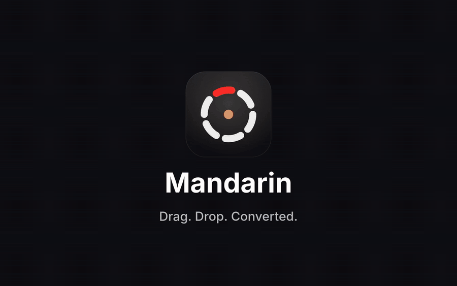

# Mandarin

A macOS menu-bar app that turns "drag a file, drop it on a wheel" into file conversion, quick file tools and common file actions, entirely offline.



## Download

1. Download `Mandarin-0.1.0-arm64.dmg` from the [Releases](https://github.com/baran-cicek/Mandarin/releases) page (Apple Silicon, macOS 13 or later).
2. Open it and drag **Mandarin** into **Applications**.
3. The app is not notarized. On first launch, right-click it and choose **Open**. If macOS still blocks it, run `xattr -dr com.apple.quarantine /Applications/Mandarin.app`.
4. Allow **Accessibility** and **Input Monitoring** in System Settings → Privacy & Security.
5. Some formats need helper tools: `brew install ffmpeg pandoc unar webp`.

Prefer to build it yourself? See below.

Mandarin is inspired by drag-and-drop radial menus.

## Install in 60 seconds (build from source)

```sh
git clone https://github.com/baran-cicek/Mandarin.git mandarin && cd mandarin && ./install.sh
```

`install.sh` checks your Mac, installs the missing Homebrew tools (after telling you what and why), builds the app, copies it to `/Applications` and prints the permissions you need to grant. It never uses `sudo` and is safe to run again. `./install.sh --prefix ~/Applications` installs somewhere else; `./uninstall.sh` removes it.

## Requirements

- macOS 13 (Ventura) or later, Apple Silicon
- Xcode Command Line Tools (`xcode-select --install`); full Xcode is not needed
- [Homebrew](https://brew.sh) for the helper tools in the `Brewfile` (ffmpeg, pandoc, unar, webp, LibreOffice)

## Using it

1. **Start dragging** a file (from Finder, the Desktop, anywhere).
2. **Tap a modifier key** while dragging. A wheel appears at the pointer.
3. **Move onto a segment and drop.** The result appears next to the original.
4. **Escape** cancels at any time, even mid-drag.

| Key | Wheel | What it does |
|---|---|---|
| **Shift** | Convert | Turns the file into another format |
| **Command** | File Tools | Resize, crop, trim, compress, merge and more |
| **Control** | File Actions | AirDrop, Float, Copy, Move, Copy Path, Open in Terminal |

The keys can be remapped in Settings. Without dragging: select a file in Finder and press **Return** to open the Convert wheel, move with the **arrow keys**, apply with **Return**, cancel with **Escape**; the other trigger keys switch to the other wheels. On a trackpad, hold a file briefly before dragging and the Convert wheel opens by itself.

### Convert wheel (Shift): what each file can become

The wheel only shows formats that make sense for the file you drag, and hides the file's own format. Formats that need a helper tool (ffmpeg, pandoc, unar, cwebp, LibreOffice) only appear while that tool is installed.

| You drag | You can convert it to |
|---|---|
| Image (JPG, PNG, HEIC, TIFF, BMP, AVIF, WebP, SVG) | JPG, PNG, WebP, HEIC, TIFF, AVIF, BMP, PDF (SVG is input only; WebP output needs `cwebp`) |
| PDF | JPG, PNG, TXT, Markdown |
| Audio (MP3, WAV, FLAC, OGG, Opus, AIFF, WMA) | MP3, M4A, WAV, FLAC, OGG, Opus, AIFF, WMA |
| Video (MP4, MOV, MKV, WebM, AVI, WMV) | MP4, MOV, MKV, WebM, AVI, WMV, GIF, plus audio only as MP3 or M4A |
| GIF | The video formats above, plus MP3 and M4A |
| Word (DOCX), RTF, TXT | DOCX, Markdown, TXT, EPUB, HTML (RTF to DOCX, TXT and HTML too) |
| Markdown, EPUB | DOCX, TXT, EPUB, HTML, Markdown (needs pandoc) |
| HTML | Markdown, EPUB (needs pandoc) |
| Spreadsheets (XLSX, XLS, ODS, CSV, TSV) | PDF, XLSX, ODS, CSV, TSV (needs LibreOffice, except CSV to TSV and back) |
| Slides (PPTX, PPT) | PDF, JPG, PNG (needs LibreOffice) |
| Subtitles (SRT, VTT) | SRT, VTT, TXT |
| Archives (ZIP, TAR, GZ, RAR) | ZIP, TAR, GZ (RAR can be opened, not created; needs unar) |

Exactly which formats appear depends on the installed tools. To zip ordinary files, use the Compress tool on the File Tools wheel (Command). In Settings you can switch individual target formats off.

Several files at once work too (for example a whole folder of images to PNG). With several files selected the wheel offers only the formats every one of them can become, and each file is converted on its own.

### File Tools wheel (Command): 27 tools

The wheel shows only the tools that apply to the file type.

| File type | Tools |
|---|---|
| Images (8) | Compress, Resize, Crop, Rotate, Flip, Grayscale, Strip Metadata, Background |
| Video (9) | Compress, Resize, Crop, Trim, Rotate, Change Speed, Extract Audio, Merge, Grayscale |
| Audio (3) | Trim, Change Speed, Merge |
| PDF (6) | Compress, Split, Merge, Rotate Pages, Extract Pages, Strip Metadata |
| Any file or folder (1) | Compress (into a ZIP) |

The counts are per file type; Compress is added to every file's wheel, so an image gets 8 + Compress. Merge appears only when more than one file is selected, and Background only for a single file. When a mix of types is selected, the wheel shows the tools of all of them and each tool only touches the files it applies to.

### File Actions wheel (Control)

| Action | What it does |
|---|---|
| AirDrop | Send the file with AirDrop |
| Float | Shows a small always-on-top preview card (thumbnail and file name) in the bottom-right corner of the main screen, one per file. Close it with its x button; Escape closes all of them. The file itself is not touched |
| Copy | Asks you for a destination folder, then copies the file there |
| Move | Asks you for a destination folder, then moves the file there |
| Copy Path | Puts the full path on the clipboard (one path per line for several files) |
| Terminal ("Open in Terminal") | Opens Terminal.app in the file's folder, or in the folder itself if you dragged a folder |

File Actions work on any file, folder or mixed selection. Copy and Move never overwrite: a name clash becomes `photo 2.png`.

### Visual editors

For a single file, some tools open an editor window instead of a number sheet. Escape closes any editor without saving; every editor saves a new copy.

| Editor | Opens for | What you can do |
|---|---|---|
| Photo editor | Crop, Resize, Rotate, Flip, Grayscale on one image | Draggable crop box with aspect presets, live brightness/contrast/saturation, before/after |
| PDF page grid | Extract Pages, Rotate on one PDF | Drag to reorder, delete, rotate, add another PDF |
| Background tool | Background on one image | Solid or gradient fill, color removal with tolerance, subject cutout (macOS 14+) |
| Audio editor | Trim on one audio file | Waveform, drag handles, fade in/out, volume |
| Video editor | Trim on one video | Timeline with thumbnails, live preview, fast lossless cut or crop |

### Results

Results land next to the original (or in the output folder chosen in Settings) and never overwrite anything: `photo.png` becomes `photo 2.png`. A small HUD shows progress, offers Cancel, and shows "Reveal in Finder" or a clear error.

## What works

| Area | Status | Notes |
|---|---|---|
| Images: JPG, PNG, HEIC, TIFF, BMP, AVIF, WebP, PDF, SVG in | Works | WebP output needs `cwebp` |
| Audio and video: MP3, M4A, WAV, FLAC, OGG, Opus, AIFF, WMA, MP4, MOV, MKV, WebM, AVI, WMV, GIF | Works | AVFoundation where possible, otherwise ffmpeg |
| PDF to JPG / PNG / TXT / Markdown | Works | Native PDFKit |
| Text documents: DOCX, Markdown, TXT, EPUB, HTML, RTF in | Works | |
| Spreadsheets and slides to PDF or other office formats | Best effort | Through LibreOffice; layout may differ |
| PDF compression, slide rendering | Best effort | HUD notes it when done |
| Subtitles: SRT, VTT, TXT | Works | |
| Archives: ZIP, TAR, GZIP out; RAR in | Works | |
| File Tools (27) | Works | Shown only for file types they apply to |
| Visual editors (photo, PDF pages, background, audio trim, video trim) | Works, newer than the rest | Open from the File Tools wheel for a single file; numeric sheets remain for multi-file drops. Live video/audio preview depends on what macOS can play; MKV/WebM/OGG can be trimmed but not previewed |
| **PDF to DOCX / PPTX / XLSX / EPUB** | **Not supported** | No available tool does this faithfully; Mandarin says so instead of faking it |
| **Anything to Pages** | **Not supported** | |

## Permissions

| Permission | Why |
|---|---|
| Accessibility | Notice that you're dragging a file and place the wheel at the pointer |
| Input Monitoring | See Shift / Command / Control / Option taps and Escape during a drag |
| Automation (Finder) | Asked once, for the Return-key flow, to read Finder's selection |

Nothing leaves your Mac: no networking code, no telemetry, no entitlements. `SECURITY.md` explains how to verify that.

## Troubleshooting

- **The wheel doesn't appear after a rebuild or reinstall.** macOS ties permissions to the app's signature. In System Settings → Privacy & Security, remove the app from Accessibility and Input Monitoring and add it again, then relaunch.
- **"ffmpeg not found" (or pandoc, unar, cwebp, LibreOffice).** Run `brew bundle` in the repo folder, or re-run `./install.sh`. The HUD names the missing tool and the install command.
- **Return in Finder does nothing.** Allow Mandarin to control Finder under Privacy & Security → Automation.
- **Build fails with `@State` or XCTest errors.** Don't use them; see `CONTRIBUTING.md`.

## Status

Early stage. A large part of the code was written with AI assistance and is covered by automated tests (`make test`), but expect rough edges, and please report them. Release builds are ad-hoc signed; a notarized build script exists (`release.sh`) but needs an Apple Developer ID.

## Development

`make test` runs the self-tests, `make app` builds `dist/Mandarin.app`. See `CONTRIBUTING.md`, `THIRD_PARTY.md`, `SECURITY.md` and `PROGRESS.md` (the full build log).

## License

MIT, see `LICENSE`. Helper tools keep their own licenses; see `THIRD_PARTY.md`.
